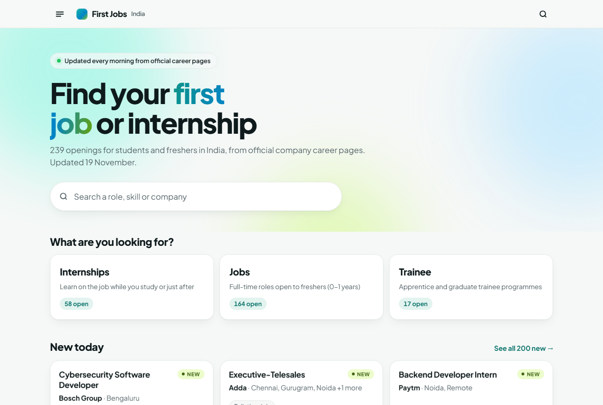
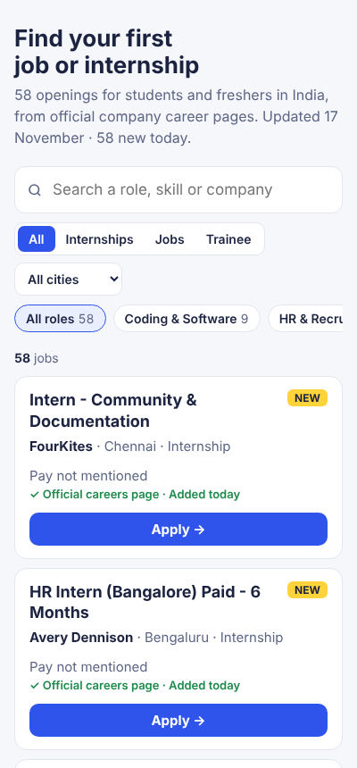

# First Jobs India

[](https://github.com/vrushali-pixel/beep-jobs/actions/workflows/ci.yml)
[](https://github.com/vrushali-pixel/beep-jobs/actions/workflows/daily.yml)

[](LICENSE)

**A daily feed of real internships and fresher jobs in India, straight from companies' official
job boards, de-duplicated, tagged by an LLM with role and city, and shown on a simple search page.**

**Live:** https://vrushali-pixel.github.io/beep-jobs/ · refreshes itself every day at 6:10 AM IST

<p>
  
  
</p>

## Why

Students looking for their first job face two problems: fake or paid "jobs", and a clutter of
listings that never say whether a fresher can even apply. This tool reads only what companies
publish on their own job boards, keeps only India roles open to freshers, and shows each one with
a plain role name, city and requirements, so a student can decide in five seconds.

## How it works


- **Official sources only:** Greenhouse, Lever, Ashby, SmartRecruiters, Workable, Recruitee, Breezy HR and
  Keka (careers pages only, as its robots.txt allows) public job feeds. No
  aggregators, no logins, no scraping; a site that refuses (HTTP 429) is never retried. [Why](docs/decisions/0001-official-job-boards-only.md)
- **Rules first, LLM for the grey zone:** free rules drop the obvious cases; the LLM reads the
  description only when the title cannot say whether a fresher can apply. Answers use a strict
  JSON schema where roles and cities are enums. [Why](docs/decisions/0002-rules-first-llm-for-the-grey-zone.md)
- **Never breaks:** a dead board, a failed LLM call or a used-up free quota is logged and the run
  still publishes; posts from a board that is down are kept, not wiped.
- **Free to run:** GitHub Actions + GitHub Pages + Gemini free tier, behind a provider interface
  that also supports Claude. [Why](docs/decisions/0004-free-llm-provider-agnostic.md)

Full details: [Architecture](docs/ARCHITECTURE.md) · [User stories](docs/STORIES.md) ·
[Decisions](docs/decisions/) · [Build log: what broke and how it was fixed](docs/BUILD_LOG.md)

## Numbers (19 Nov 2026)

One daily run, from 147 official company job boards on 8 platforms:

| Step | Posts |
|---|---|
| Fetched | 13,274 |
| Outside India (dropped) | 9,608 |
| Senior title (dropped) | 2,011 |
| Description requires 1+ years of experience (dropped by a plain rule) | 848 |
| Left for screening, after merging 174 duplicates | 633 |
| **Live: India roles a fresher can really apply to** | **243** |

| | |
|---|---|
| Role tag correct | 94% (first 50-post sample) · 89% (a second, fresh sample of 28 live posts) |
| City tag correct | 98% · 100% |
| Cost per 1,000 posts | **$0.39** at Gemini 3.5 Flash-Lite paid prices (280 input + 121 output tokens per post); **$0 actually paid** (free tier) |
| Run time | ~13 minutes, of which most is politely reading descriptions |
| Tests | 57 offline tests, lint, on every push |

The accuracy samples were checked by Claude (a second model) against each full post, not yet by a
person: see `eval/sample_50.csv` and `eval/sample_v2.csv`.

### How it went from 93 to 243

- **The first four platforms barely cover Indian startups.** Greenhouse, Lever, Ashby and
  SmartRecruiters are mostly used by US-style companies. On 19 Nov we added four more official
  feeds that Indian companies use: Workable, Recruitee, Breezy HR and Keka (an Indian HR tool).
  20 new boards took the live count from 93 to 243 ([BUILD_LOG #28](docs/BUILD_LOG.md)).
- **The rules did not change.** The same "0–1 years" filter, the same prompt v3. In a fresh check
  before this, 16 of 50 posts that the first prompt allowed actually asked for 1 to 8 years of
  experience; they are still dropped ([BUILD_LOG #26, #27](docs/BUILD_LOG.md)).
- **Only employers' own boards.** Recruitment agencies and gig platforms that post jobs for other
  companies were left out on purpose, and Workday sites that refuse automated requests (HTTP 429)
  stay off ([ADR 0003](docs/decisions/0003-workday.md)).
- **Note:** almost half of the live posts (114) come from Workable, and many of those are field
  sales and counsellor roles (Rentokil PCI, Apna). They are real entry-level jobs, but the mix leans
  toward sales until campus hiring opens in January to March.
- **Growing it is config, not code:** each new company is one line in `config/companies.yaml`.
  The best next source is Beep's own hiring partners ([S18](docs/STORIES.md)).

## Quick start

```bash
git clone https://github.com/vrushali-pixel/beep-jobs && cd beep-jobs
pip install -e ".[dev]"
make test                          # 57 offline tests, no API key needed
export GEMINI_API_KEY=...          # free key from aistudio.google.com (optional)
fresherjobs run                    # fetch → filter → de-dupe → tag → publish
make serve                         # open http://localhost:8000
```

| Command | Does |
|---|---|
| `fresherjobs run` | The daily pipeline |
| `fresherjobs discover` | Checks every company board and counts India entry-level posts |
| `fresherjobs sample` | Picks 50 random live posts to hand-check |
| `fresherjobs score FILE` | Accuracy for role, city, both + cost per 1,000 posts |

**Deploy your own:** fork, add `GEMINI_API_KEY` under Settings → Secrets → Actions, set
Settings → Pages → Source to "GitHub Actions", then Actions → Daily job refresh → Run workflow.

## Change it without touching code

| To… | Edit |
|---|---|
| Add a city or spelling | `config/settings.yaml` → `cities` |
| Add or rename a role group | `config/settings.yaml` → `roles` (label, LLM hint, fallback keywords) |
| Add a company | `config/companies.yaml`, then `fresherjobs discover` |
| Make the fresher filter stricter | `config/settings.yaml` → `senior_title_words` / `entry_title_words` |
| Improve the prompt | copy to `config/prompts/tagger_v3.md`, point `llm.prompt_file` at it |
| Switch to Claude | `llm.provider: anthropic`, `llm.model: claude-haiku-5-5`, secret `ANTHROPIC_API_KEY` |
| Change the refresh time | `.github/workflows/daily.yml` → `cron` (UTC) |

## Project layout

```
config/            settings.yaml · companies.yaml · prompts/      ← everything you edit
src/fresherjobs/
  sources/         greenhouse · lever · ashby · smartrecruiters · workable · recruitee ·
                   breezy · keka · workday (off)
  filters.py       India / entry-level / scam rules
  dedupe.py        same link or same company + role → one post
  tagging/         prompt + schema · providers (Gemini, Claude) · tagger · keyword fallback
  store.py         merge with yesterday: new / closed / expired
  publish.py       page JSON, CSV, run stats, rejected list
  pipeline.py      connects the steps        cli.py   commands
  evaluation.py    accuracy and cost
site/index.html    the page (one static file)
data/              db, LLM cache, run log, rejected posts (written by the daily run)
tests/             57 offline tests, one file per module
docs/              architecture, stories, decisions, build log
```

## Roadmap
Report-a-job button feeding the red-flag list · Beep hiring partners as a direct source ·
alerts for new posts in a student's city and role. See [stories S17–S19](docs/STORIES.md#next).

---

Built by Vrushali Patil with Claude (Anthropic) as an AI pair programmer, as the build round for
Beep's Gen AI & Engineering role. MIT licensed.
