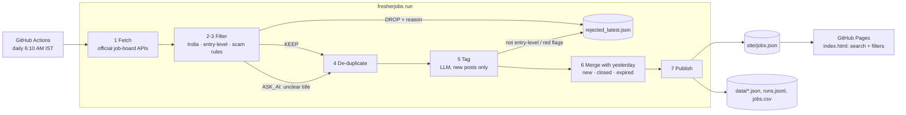

# Architecture

## The pipeline

| Step | Module | What it does | Fails safely because |
|---|---|---|---|
| 1 Fetch | `sources/` | One small module per provider (Greenhouse, Lever, Ashby, SmartRecruiters, Workable, Recruitee, Breezy HR, Keka); all return the same `RawPost` shape | A board that errors is logged and skipped; a 429 is respected, never retried |
| 2-3 Filter | `filters.py` | `Rules.check()` → KEEP, ASK_AI, or a drop reason. Descriptions are fetched only when they can change the answer | Pure functions, unit-tested on real titles |
| 4 De-dupe | `dedupe.py` | Same link, or same company + cleaned title → one post with all its cities; stable id across days | — |
| 5 Tag | `tagging/` | Prompt + strict schema → provider (Gemini or Claude) → validate → cache | No key / failed call / quota gone → keyword fallback; unclear titles held back |
| 6 Merge | `store.py` | Keeps `first_seen`; a post missing from a board that answered is closed | A board that is down keeps its posts until 30 days unseen |
| 7 Publish | `publish.py` | Page JSON, CSV, run stats, rejected list | — |
| Orchestration | `pipeline.py`, `cli.py` | Connects the steps, counts everything | — |

## Data files

| File | Written by | Purpose |
|---|---|---|
| `site/jobs.json` | publish | What the page shows (live posts + today's stats) |
| `data/db.json` | store | Every post ever seen, with `status` active/closed/expired and `first_seen`/`last_seen` |
| `data/tags_cache.json` | tagging | LLM answers keyed by `prompt-file:post-id`, so each post is paid for once |
| `data/runs.jsonl` | publish | One line per run: counts, tokens, seconds. Source for cost per 1,000 posts |
| `data/rejected_latest.json` | publish | Every post dropped today and why (audit trail) |
| `data/jobs.csv` | publish | Live posts for a spreadsheet |

## One post's journey

`"SDE-I Intern – Payments (2027), Bangalore"` from a Greenhouse board:

1. **Fetch:** Greenhouse API → `RawPost` with location "Bengaluru, India" and the HTML description as plain text.
2. **Filter:** India ✓ (city alias), title has "intern" → KEEP.
3. **De-dupe:** id = hash of `acme|sde i intern payments`; a "– Hyderabad" copy merges into it.
4. **Tag:** the LLM returns `role_group: coding`, `clean_title: "Software Developer Intern"`,
   `cities: ["Bengaluru", "Hyderabad"]`, `job_type: internship`, skills, eligibility, pay, `red_flags: []`.
5. **Merge:** new today → `first_seen = today`, shown with a NEW badge.
6. **Next days:** seen again → `last_seen` moves; gone from a board that answered → `closed`.

## Configuration (`config/`)

| File | Holds |
|---|---|
| `settings.yaml` | LLM provider/model/batch size/pacing, role groups (label, LLM hint, fallback keywords), job types, canonical cities + spellings, filter words, scam phrases, expiry |
| `companies.yaml` | Company boards per provider; Workday switch |
| `prompts/tagger_v3.md` | The tagging prompt; `{ROLE_LIST}` and `{CITY_LIST}` are filled from settings so they never drift |

## Limits and next steps
- Volume depends on India-heavy boards; internships peak January–March.
- Workday MNC sites refuse automated requests (decision 3).
- Next: Beep's own hiring partners as a direct source; a "report this job" button feeding the
  red-flag list; per-student alerts.
